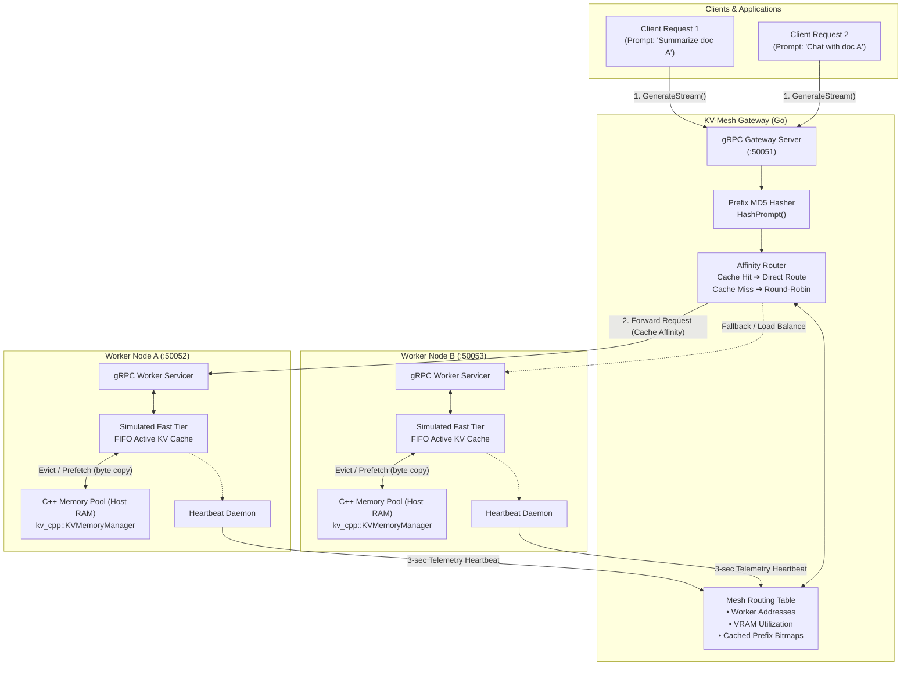
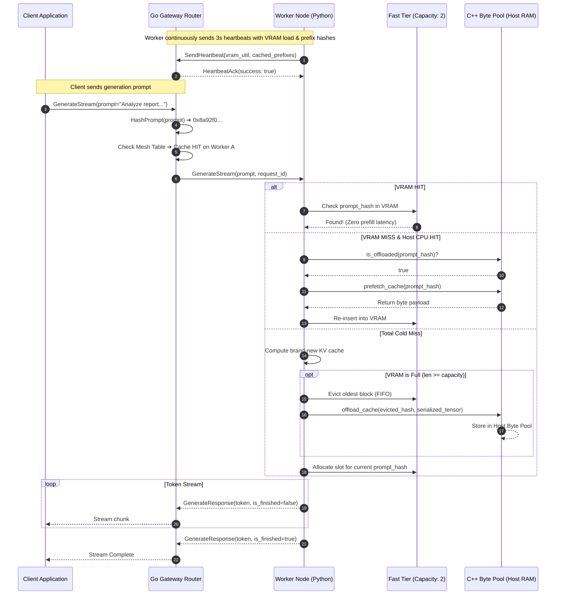

# ⚡ KV-Mesh

<div align="center">

```
  ██ ▄█▀ ██▒   █▓     ███▄ ▄███▓▓█████   ██████  ██░ ██ 
  ██▄█▒ ▓██░   █▒    ▓██▒▀█▀ ██▒▓█   ▀ ▒██    ▒ ▓██░ ██▒
 ▓███▄░  ▓██  █▒░    ▓██    ▓██░▒███   ░ ▓██▄   ▒██▀▀██░
 ▓██ █▄   ▒██ █░░    ▒██    ▒██ ▒▓█  ▄   ▒   ██▒░▓█ ░██ 
 ▒██▒ █▄   ▒▀█░      ▒██▒   ░██▒░▒████▒▒██████▒▒░▓█▒░██▓
 ▒ ▒▒ ▓▒    ░ ░      ░ ▒░   ░  ░░░ ▒░ ░▒ ▒▓▒ ▒ ░ ▒ ░░▒░▒
 ░ ░▒ ▒░    ░ ░      ░  ░      ░ ░ ░  ░░ ░▒  ░ ░ ▒ ░▒░ ░
 ░ ░░ ░       ░      ░      ░      ░   ░  ░  ░   ░  ░░ ░
 ░  ░         ░             ░      ░  ░      ░   ░  ░  ░
```

**A High-Performance Distributed LLM Inference Router with Prefix-Cache-Aware Routing & Heterogeneous Tiered KV-Memory Offloading.**

---

[](https://golang.org)
[](https://python.org)
[](https://isocpp.org)
[](https://grpc.io)
[](https://protobuf.dev)
[](LICENSE)

</div>

---

## 📖 Overview

> **Status: research prototype.** The worker in this repository does **not** run a language model and does **not** allocate GPU memory. It emits a synthetic response, models the KV cache as a small list of fingerprints, and models the host tier as a byte pool in C++. The project exists to make the *control plane* — prefix-cache-aware routing, worker liveness and a tiered cache lifecycle — inspectable and measurable. The manuscript at [`paper/kv-mesh.pdf`](paper/kv-mesh.pdf) states exactly which claims the code supports and which it does not.

In modern Large Language Model (LLM) serving architectures, **Time-To-First-Token (TTFT)** and **Compute Overhead** are dominated by redundant **prefill phases** for repeated system prompts, multi-turn chat sessions, and document retrieval (RAG) contexts.

**KV-Mesh** addresses the *placement* problem in that setting by coordinating distributed inference nodes into a cache-aware mesh:
1. **Prefix-Cache-Aware Routing**: A high-throughput, non-blocking **Go Gateway** analyses incoming prompts, computes prefix hashes, and dispatches generation requests directly to worker nodes that advertise the required Key-Value (KV) cache fingerprint.
2. **Tiered KV State Offloader**: When the simulated fast tier reaches capacity, a **C++ / pybind11 memory manager** offloads evicted KV blocks from the fast tier into a host-memory byte pool, pre-fetching them back on demand to avoid expensive recalculation. *(Modelled with byte copies; no PCIe transfer is performed.)*
3. **Real-Time Mesh Telemetry**: Distributed Python workers broadcast their simulated fast-tier occupancy and cached fingerprints over low-overhead gRPC heartbeats to keep the gateway's routing table synchronised.

### 📄 Research paper

The manuscript is built from LaTeX sources in [`paper/`](paper/) and is accompanied by a reproducible evaluation harness in [`experiments/`](experiments/).

| | |
|---|---|
| **Paper (PDF)** | [`paper/kv-mesh.pdf`](paper/kv-mesh.pdf) — 17 pages, built with `tectonic` |
| **Paper source** | [`paper/kv-mesh.tex`](paper/kv-mesh.tex), tables in `paper/tables/`, figures in `paper/figures/` |
| **Evaluation harness** | [`experiments/`](experiments/) — simulator, live-system harness, microbenchmarks, analysis |
| **Archived results** | [`experiments/results/`](experiments/results/) — per-run summaries, raw per-request event streams, environment capture |

The paper's evaluation has three arms: a discrete-event **simulator** of the control plane (the factorial sweep), a **live-system** arm that drives the real Go gateway and Python workers over gRPC, and **microbenchmarks** of the routing decision and the byte pool. Headline results are in [§6 of the paper](paper/kv-mesh.pdf).

---

## 🏛️ High-Level System Architecture



---

## 🔄 Request Lifecycle & Cache Hit Sequence

The diagram below illustrates the end-to-end flow when a request matches an existing prefix in the mesh, versus when memory pressure triggers the heterogeneous C++ tiered offloader:



---

## 🌟 Key Technical Features

### 1. Prefix-Aware Cache Affinity Routing
Standard round-robin or least-connection routing causes frequent cache churn because identical prefixes land on arbitrary workers. **KV-Mesh** inspects the prompt prefix at the gateway, converts it to a 64-bit fingerprint (`HashPrompt`), and matches it against the cluster's active cache index:
- **Cache Hit**: Request routed directly to the worker with the warm cache, bypassing full prompt token prefill and drastically reducing **TTFT**.
- **Cache Miss**: Request dispatched via load-balancing fallback to distribute generation load.

### 2. Heterogeneous Tiered Memory Subsystem (`C++ / pybind11`)
Fast memory is scarce and expensive. KV-Mesh models a two-tier memory hierarchy:
- **Tier 1 (simulated fast tier)**: The tier in which active sequence blocks would reside on a GPU. In this prototype it is a list of fingerprints of bounded length.
- **Tier 2 (host memory)**: Managed through `kv_cpp::KVMemoryManager`. Evicted entries are copied into a host-memory map instead of being discarded. The copy is a byte copy, **not** a PCIe transfer; no CUDA memory is involved.
- **Prefetch on Demand**: When a previously offloaded prefix is requested again, the C++ backend pre-fetches the tensor data back into VRAM, converting what would be a costly $O(N)$ transformer recomputation into a lightweight memory transfer.

### 3. Asynchronous Health & Topology Convergence
Workers run a background daemon thread that periodically transmits telemetry:
- Worker ID and reachable gRPC network address.
- Active VRAM utilization ratio.
- Bitmap/list of currently cached prefixes.
- Gateway maintains an auto-expiring worker table (10-second heartbeat TTL) to cleanly evict dead nodes.

---

## 📁 Repository Structure

```
kv-mesh/
├── proto/
│   └── kvmesh.proto                  # Protobuf definition (WorkerNode & GatewayNode services)
├── gateway/
│   ├── go.mod                        # Go module definition
│   ├── go.sum                        # Go module checksums
│   ├── main.go                       # Gateway gRPC server, stream proxy & metrics endpoint
│   ├── bin/                          # Built gateway binary
│   ├── cmd/hashprobe/                # Fingerprint probe used by the cross-language test
│   ├── metrics/                      # Gateway metrics collector (JSON /metrics endpoint)
│   ├── pb/                           # Compiled Go Protobuf stubs
│   └── router/
│       ├── router.go                 # Cache-aware routing table & hash algorithms
│       ├── router_test.go            # Unit tests (TTL, matching, determinism, races)
│       └── router_bench_test.go      # Routing-decision microbenchmarks
├── worker/
│   ├── cpp_extension/
│   │   └── memory_manager.cpp        # C++ pybind11 host-memory byte pool
│   ├── setup.py                      # Build script for C++ native extension
│   ├── main.py                       # Python Worker Node (gRPC servicer + memory manager)
│   ├── client.py                     # CLI test client for streaming inference
│   ├── kvmesh_pb2.py                 # Compiled Python Protobuf classes
│   └── kvmesh_pb2_grpc.py            # Compiled Python gRPC stubs
├── paper/
│   ├── kv-mesh.tex                   # Manuscript source
│   ├── kv-mesh.pdf                   # Built manuscript
│   ├── tables/                       # Generated LaTeX table fragments
│   └── figures/                      # Generated vector figures
├── experiments/
│   ├── configs/                      # Sweep definitions (YAML)
│   ├── exp/                          # Simulator, live harness, analysis library
│   ├── scripts/                      # Sweep / live / benchmark / report drivers
│   ├── tests/                        # Cross-language and simulator invariant tests
│   └── results/                      # Archived results, raw event streams, environment capture
├── Makefile                          # Build, test, reproduce and paper targets
├── requirements.txt                  # Python dependencies (gRPC, pybind11, vLLM, PyTorch)
├── .gitignore
└── README.md
```

---

## 🚀 Getting Started

### Prerequisites

- **Go**: 1.22+ installed
- **Python**: 3.10+ (tested on Python 3.11 & 3.12)
- **C++ Compiler**: GCC / Clang with C++17 support and python development headers (`python3-dev`)
- **Protocol Buffers Compiler** (`protoc`) with Go and Python plugins

---

### Installation & Build

#### 1. Clone the Repository
```bash
git clone https://github.com/your-username/kv-mesh.git
cd kv-mesh
```

#### 2. Python Environment & C++ Module Compilation
Create a virtual environment and install the required dependencies:
```bash
python -m venv .venv
source .venv/bin/activate       # On Linux / WSL / macOS
# or: .venv\Scripts\activate    # On Windows PowerShell

pip install -r requirements.txt
```

Compile the C++ heterogeneous memory extension:
```bash
cd worker
python setup.py build_ext --inplace
cd ..
```
> *This produces `kv_cpp.*.so` (or `.pyd` on Windows), allowing Python to call the native C++ memory pool.*

---

#### 3. (Optional) Recompiling Protocol Buffers

If you make modifications to [proto/kvmesh.proto](file:///d:/kv-mesh/proto/kvmesh.proto):

**Generate Python Stubs:**
```bash
python -m grpc_tools.protoc -Iproto --python_out=worker --grpc_python_out=worker proto/kvmesh.proto
```

**Generate Go Stubs:**
```bash
protoc --proto_path=proto \
       --go_out=gateway/pb --go_opt=paths=source_relative \
       --go-grpc_out=gateway/pb --go-grpc_opt=paths=source_relative \
       proto/kvmesh.proto
```

---

## 🖥️ Running the Cluster

Open separate terminal windows (or multiplex with `tmux` / WSL):

### Step 1: Start the Go Gateway
```bash
cd gateway
go run main.go
```
*Output:*
```
[Gateway] KV-Mesh Gateway running on port :50051
```

### Step 2: Start Worker Nodes
Spawn two or more worker nodes on different ports. Each worker will register itself with the gateway:

**Terminal A (Worker 1):**
```bash
cd worker
python main.py --port 50052
```

**Terminal B (Worker 2):**
```bash
cd worker
python main.py --port 50053
```

Within 3 seconds, workers will publish their first heartbeat and the Gateway will log the registration:
```
[C++ Backend] Heterogeneous Memory Pool Initialized.
Worker a8b12f4c started on port 50052.
```

---

### Step 3: Run Inference Queries

Send queries to the cluster through the Gateway:

```bash
cd worker

# Query 1: Initial prompt (Cold Miss -> Worker A computes and caches)
python client.py "Explain quantum computing in simple terms"

# Query 2: Repeated prompt (Cache HIT -> Gateway immediately routes to Worker A!)
python client.py "Explain quantum computing in simple terms"

# Query 3: Different prompt (Dispatched to distribute load)
python client.py "Write a fast matrix multiplication kernel"
```

---

## 🔬 Memory Eviction & Tiering in Action

The simulated worker environment models a realistic VRAM constraint (capacity = 2 cache slots). Watch the worker console when issuing queries:

1. **First Request**:
   ```
   [Worker] Total MISS. Computing new KV cache...
   ```
2. **Second Repeated Request**:
   ```
   [Router] KV Cache HIT! Routing hash 178291048291 to worker a8b12f4c
   [Worker] VRAM HIT for hash 178291048291
   ```
3. **Fast-tier saturation and host offload**:
   ```
   [Worker] VRAM FULL. Evicting hash 49102840192 to host pool.
   [C++ Backend] Offloaded 1048576 bytes for hash 49102840192 to CPU RAM.
   ```
4. **Prefetching from Host RAM on Recall**:
   ```
   [Worker] VRAM MISS but CPU HIT. Pre-fetching from host pool...
   [C++ Backend] Pre-fetched hash 49102840192 (byte copy).
   ```

---

## 🔬 Reproducing the Evaluation

The paper's results are regenerated from the archived configuration files. Every command below is deterministic given its configuration and seed.

```bash
# Build everything
make build            # C++ extension, gateway binary, protobuf stubs

# Unit and invariant tests (Go race detector + pytest)
make test

# The full experimental programme (~10 minutes on 4 cores)
make experiments      # simulator sweeps, live-system arm, microbenchmarks

# Regenerate every table and figure, then rebuild the manuscript
make report
make paper            # writes paper/kv-mesh.pdf
```

Individual steps:

```bash
# One sweep (the factorial design of §5.3)
.venv/bin/python experiments/scripts/run_sweep.py \
    --config experiments/configs/main.yaml --out experiments/results/main --clean

# The live-system arm: real gateway, real workers, real gRPC
.venv/bin/python experiments/scripts/run_live.py --out experiments/results/live

# Component microbenchmarks
.venv/bin/python experiments/scripts/bench_pool.py --out experiments/results/microbench/pool_benchmark.json
cd gateway && go test -run XXX -bench . -benchmem ./router/ > ../experiments/results/microbench/router_bench.txt

# Tables and figures
.venv/bin/python experiments/scripts/make_report.py
```

**Artifacts.** `experiments/results/<sweep>/<run-key>/summary.json` holds every run's configuration and aggregate metrics; runs selected by the `keep_records` rule additionally archive the full per-request event stream (`requests.jsonl.gz`). `experiments/results/main/environment.json` records the machine, the toolchain versions and the repository commit. `experiments/results/aggregate.csv` is a flat table of every experimental cell.

**Statistical treatment.** Means are reported with 95 % bootstrap confidence intervals over the repetitions of a cell; policy comparisons use a paired bootstrap over the replicate index together with Cohen's $d$.

---

## 🗺️ Roadmap

- [x] High-performance Go Gateway with dynamic worker registry
- [x] Prefix hashing and cache affinity routing
- [x] Native C++ heterogeneous memory pool (`pybind11`)
- [x] Asynchronous heartbeat & telemetry distribution
- [x] Deterministic, race-free routing (atomic cursor, stable worker order, heartbeat sequencing)
- [x] Routing-decision instrumentation (decision log, metrics endpoint, per-request ground truth)
- [x] Reproducible evaluation harness (simulator, live-system arm, microbenchmarks, analysis)
- [ ] **Radix Tree Prefix Indexing**: Multi-token hierarchy matching (compatible with SGLang / vLLM RadixAttention)
- [ ] **Engine-integrated cache keys**: Replace the exact-string fingerprint with a token-block prefix identifier bound to the model and tokeniser revision
- [ ] **Real KV tensors**: Integrate with a supported inference engine's cache interface and move genuine KV blocks between device and host memory
- [ ] **Cross-Worker KV Cache Transfer**: P2P RDMA/NCCL transfer of cache blocks directly between workers across the mesh
- [ ] **OpenAI-Compatible HTTP API**: Reverse proxy endpoint accepting standard `/v1/chat/completions`

---

## 📄 License

This project is licensed under the Apache 2.0 License. See the [LICENSE](LICENSE) file for details.
